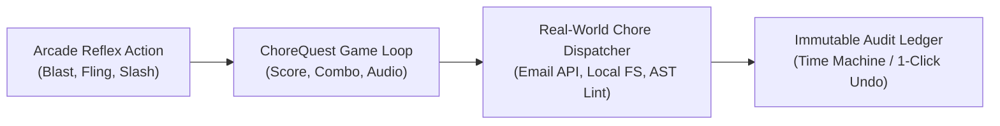

# ChoreQuest: Play Fast. Clean Real. 🎮✨

> **The Productivity Arcade: Where playing fast-paced games actually executes painful real-world digital chores in the background.**

[](#)
[](#)
[](#)

---

## ⚡ Why We Procrastinate (and Why ChoreQuest Works)

Cleaning 5,000 unread emails, organizing messy Desktop downloads, reviewing bank statements for zombie subscriptions, or fixing 100 lint errors are **cognitively exhausting** chores. They involve:
- **Paralyzing Volume**: Hundreds of micro-decisions without a clear beginning or end.
- **Dopamine Desert**: No immediate feedback loop until hours of boring clicks later.
- **Decision Fatigue**: "Should I keep this? Where should this file go? Is this newsletter useful?"

### The ChoreQuest Solution
Arcade games and rogue-likes thrive on **rapid, clear, micro-decisions** with tight feedback loops:
- Slicing, blasting, flinging, or banishing feels satisfying and takes **200 milliseconds**.
- Each reflex action in the game **is 1:1 bound to an actual chore command** dispatched in the background.
- You get combos, particle bursts, synthesized audio fanfares, and an **inbox that reaches zero while you play**.



---

## 🕹️ The 4 Game Arenas & Real-World Chore Bindings

| Arena | Game Genre | Target Digital Chore | In-Game Reflex | Real-World Background Execution |
| :--- | :--- | :--- | :--- | :--- |
| **1. Cyber Inbox Invaders** | Space Arcade Shooter | 5,000 Unread Emails | **Left-Click / Space** (Plasma Laser)<br/>**Right-Click / E** (EMP Shockwave)<br/>**Q** (Tractor Beam) | **Archive & Delete** promotional spam.<br/>**Unsubscribe & Purge** marketing newsletters.<br/>**Star & Save** VIP receipts & contracts. |
| **2. Conveyor of Chaos** | Physics Chute Sorter | Messy Downloads / Desktop | **Fling / Keys 1-4** into colored wormholes | **[1] Incinerator**: Deletes obsolete installers & temp zips.<br/>**[2] Docs**: Moves PDFs & spreadsheets to `Documents/`.<br/>**[3] Media**: Vaults screenshots & clips to `Media/`.<br/>**[4] Keep**: Pins active daily work files. |
| **3. Rogue Audit: SaaS Dungeon** | Turn-Based RPG Battler | Bank Statements & SaaS Fees | **Banish / Cancel Blade**<br/>**Approve Expense**<br/>**Chargeback Dispute** | Halts monthly recurring charges & drafts cancellation links.<br/>Tags verified business expenses for tax ledger.<br/>Generates credit card dispute letters. |
| **4. Lint Strike: Code Crusher** | Cyberpunk Rhythm Sniper | Repository Lint & Syntax Debt | **Target & Click / Space** crawling bug sprites | Eliminates unused imports, deletes rogue `console.log`s, formats trailing spaces, and applies automated git patches. |

---

## 🛡️ Zero-Risk Architecture & The Time Machine

Accidentally blasted an email you needed, or flung a tax return into the trash portal? **No problem.**

1. **Immutable Action Ledger**: Every game action is logged with timestamp, target file/email ID, previous state, and action type.
2. **Instant Undo (Hotkey 'Z')**: Hit `Z` during gameplay or click **Undo** in the top bar to immediately revert the last action.
3. **Execution Mode Toggle**:
   - **High-Fidelity Simulation Sandbox**: Zero risk, test with realistic generated batches of 5,000 emails, messy files, and SaaS charges.
   - **Live Staged Execution**: Generates real staging directories, shell scripts, and review diffs.
   - **Direct Live Execution**: Connects to local directories or webhooks for immediate file organization and unsubscription dispatch.

---

## 🚀 How to Run

### 1. Launch the Full Web Arcade (Browser)
Simply double-click `index.html` or open it in any modern browser:
```powershell
Start-Process index.html
```
- Includes full 60fps HTML5 Canvas rendering.
- Built-in **Procedural Web Audio Engine** (synthesizes lasers, EMP waves, explosions, and fanfares without external audio dependencies).
- Real-time ledger modal with **CSV Export**.

### 2. Run with the Local Python File Dispatcher Backend
If you want ChoreQuest to manipulate actual test files on disk:
```powershell
python server.py
```
- Starts local server on `http://localhost:8000`.
- Provides `/api/generate_messy_folder` to create a realistic `sample_messy_downloads/` folder with installers, screenshots, and PDFs.
- Provides `/api/organize_file` to physically move and categorize real files.
- Provides `/api/undo_last` to revert physical file movements on disk.

### 3. Play the Terminal Edition (CLI Game)
For hackers who want a pure terminal experience:
```powershell
python cli_game.py
```
Interactive ANSI-colored terminal game with keyboard input, real-time score tracking, and automated manual time-saved calculations.

---

## 📂 Project Structure

```text
├── index.html       # Full Web Arcade Application (Canvas games, WebAudio synth, HUD, Ledger)
├── server.py        # Python backend dispatcher for real local disk operations & API endpoints
├── cli_game.py      # Standalone Terminal Edition of ChoreQuest
└── README.md        # Documentation and architecture guide
```

---

## 💡 Real-World Integrations & Extensibility

ChoreQuest is designed with a pluggable execution bus:
- **Gmail / Outlook API**: Connects to OAuth token to replace the mock queue with real `messages.batchDelete` and `messages.modify` endpoints.
- **List-Unsubscribe Header Parser**: Automatically extracts RFC 2369 `mailto:` or HTTP unsubscribe links when firing EMP shockwaves.
- **Local File System Access API**: Uses `window.showDirectoryPicker()` in the browser to organize folders directly without needing a local backend!
- **ESLint / Prettier CLI Bridge**: Triggers `npx eslint --fix` or AST manipulation for each squashed bug in Lint Strike.
